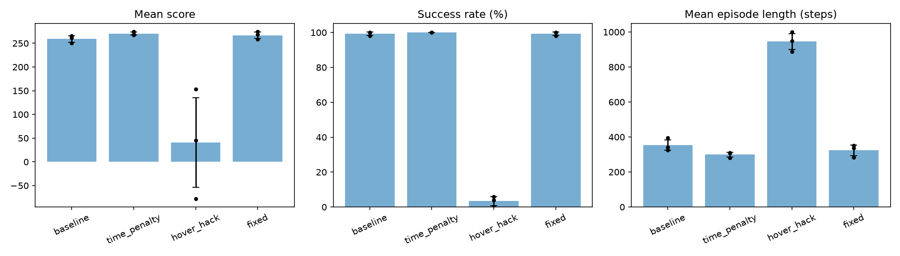

# Reward Shaping and Reward Hacking in Lunar Lander (PPO)

Trained PPO agents on Gymnasium's `LunarLander-v3` and compared four reward designs across 3 seeds each. One reward was deliberately hackable, and the agent learned to exploit it. A fixed version of the same idea removes the exploit.

## Reward variants

| Variant | Reward change |
|---|---|
| `baseline` | Built-in reward only |
| `time_penalty` | -0.03 per frame |
| `hover_hack` | +1 per frame while upright and slow (deliberately hackable) |
| `fixed` | Potential-based shaping on the same "upright and slow" condition, plus -0.03 per frame |

"Upright and slow" means |tilt| < 0.2, |sideways speed| < 0.3 and |vertical speed| < 0.3.

## Results

Each model was evaluated over 50 episodes with the original game reward (no wrapper), deterministic actions. Values are mean ± std across 3 training seeds. Success = episode score >= 200.

| Variant | Score | Success % | Episode length (steps) |
|---|---|---|---|
| baseline | 259.1 ± 6.7 | 99.3 ± 0.9 | 353 ± 30 |
| time_penalty | 270.5 ± 2.9 | 100.0 ± 0.0 | 300 ± 14 |
| hover_hack | 40.5 ± 94.3 | 3.3 ± 2.5 | 945 ± 46 |
| fixed | 266.8 ± 6.6 | 99.3 ± 0.9 | 323 ± 30 |

## Findings

- **The hack is reproducible.** With the hover bonus, success fell from about 99% to 3.3% and episodes ran about 945 steps, close to the 1,000-step limit. The agent learned to stay in the air instead of landing.
- **The hack is unstable.** Scores varied a lot between seeds (std 94.3).
- **The fix works.** Paying for the change in "upright and slow" instead of for staying there, plus a small time fee, restored 99.3% success.
- **Time penalty was the most consistent**, with the shortest episodes. With only 3 seeds, the differences between baseline, time_penalty and fixed are small and should not be treated as conclusive. The collapse of hover_hack is the clear effect.

## Limitations

- 3 seeds per variant, 1M training steps each.
- A2C was tried on the `fixed` reward with 1 seed and 2 hyperparameter settings (mean score about -108, 0% success). It did not learn to land. A2C was not tuned further, so this is not a fair comparison with PPO.

## Videos

The `videos/` folder has clips of the baseline landing, the fixed model landing, and the hover-hack model (which lands late, after long hovering).

## Reproduce

Python 3.10+ (tested on 3.13). On Windows, run `pip install swig` first if the Box2D install fails.

1. Create a virtual environment and run `pip install -r requirements.txt`.
2. Train: `python train_variant.py <variant> <seed> [ppo|a2c]`, for example `python train_variant.py fixed 0`.
3. Evaluate one model: `python evaluate_model.py ppo_fixed_s0`.
4. Evaluate all 12 and make the chart: `python evaluate_all.py` (writes `results.csv` and `results.png`).
5. Record clips: `python record_model.py ppo_fixed_s0`.

## Files

- `wrappers.py`: the reward wrappers (`TimePenalty`, `HoverBonus`, `FixedShaping`)
- `train_variant.py`: training script
- `evaluate_model.py`, `evaluate_all.py`: evaluation
- `record_model.py`: video recording
- `ppo_*.zip`: trained models